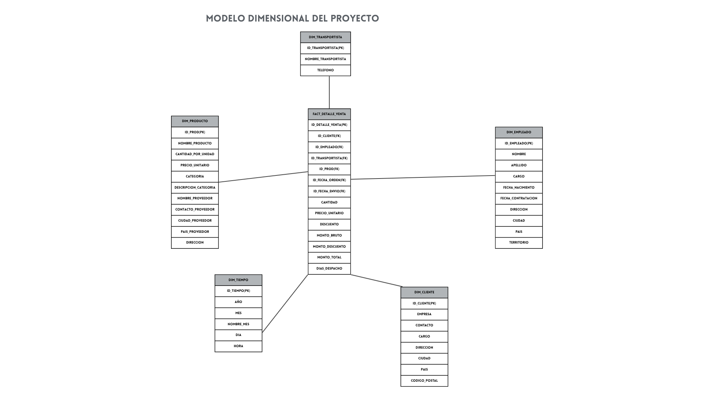

# Proyecto de Inteligencia de Negocios: Kent Foods

## Información de equipo de trabajo
- Felipe Gamboa
- Osvaldo Donoso
- Gonzalo Cayupil

## Sección y Asignatura
- **Asignatura**: Inteligencia de negocios
- **Sección**: Paralelo 300
- **Docente**: Hernan Marcelo Saavedra Gonzalez

## Caso Seleccionado:

El caso de estudio corresponde a la empresa **Kent Foods**, una organización comercial dedicada a la venta y distribución de productos alimenticios mediante despachos a domicilio y envíos. La compañía ha experimentado un crecimiento acelerado durante los últimos años, lo que ha generado una acumulación significativa de registros operacionales en su base de datos transaccional (cubriendo clientes, colaboradores, catálogo de alimentos, proveedores, transportistas y órdenes de compra con sus respectivos detalles). Ante esta expansión, el propietario de la organización requiere incorporar una arquitectura de Inteligencia de Negocios que permita transformar dichos registros operativos en información estructurada para la toma oportuna de decisiones.

## Descripción del problema

Debido al rápido crecimiento en el volumen de operaciones de Kent Foods, los directivos y encargados de área enfrentan dificultades para evaluar el desempeño real del negocio a partir de su base de datos relacional transaccional (OLTP).

## Objetivo del Proyecto

Diseñar e implementar una solución de Inteligencia de Negocios para la empresa Kent Foods, estructurando un Data Warehouse dimensional mediante la metodología Kimball y desarrollando un flujo automatizado de Extracción, Transformación y Carga (ETL) en SQL Server Integration Services (SSIS), con el fin de suministrar información confiable y métricas consolidadas que optimicen la toma de decisiones estratégicas del propietario y la gerencia.

## Creación del modelo dimensional

Para este proceso de negocio, se escogerá el modelo dimensional "**TIPO ESTRELLA**", que nos ayudará a desnormalizar las tablas operacionales y optimizar las consultas SQL

- **Proceso de negocio**: Proceso de ventas y despacho de alimentos a clientes

- **Granularidad**: fila/item de producto por venta

- **Dimensiones**: DIM_CLIENTE, DIM_PRODUCTO, DIM_EMPLEADO, DIM_TIEMPO, DIM_TRANSPORTISTA

- **Medidas**: cantidad, precio_unitario, descuento, monto_bruto(**cantidad x precio_unitario**), monto_descuento(**cantidad x precio_unitario x descuento**), monto_total (**monto_bruto - monto_descuento**), dias_despacho

- **Tabla de hechos**: FACT_DETALLE_VENTA, la cual almacena las claves foráneas de las dimensiones (id_cliente, id_producto, id_empleado, id_fecha_orden,id_fecha_envio, id_transportista)

### Esquema dimensional 

## KPIs definidos

- **Ventas Netas Totales**: 
    - **Fórmula analítica:** $\sum \text{MontoNeto} = \sum (\text{Cantidad} \times \text{PrecioUnitario} \times (1 - \text{Descuento}))$. 

    - **Dimensiones de análisis:** Dim_Tiempo (mes, dia, año), Dim_Producto (categoría de alimentos), Dim_Cliente (país/ciudad).

    - **Justificación de negocio:** Es el indicador principal de salud comercial y crecimiento financiero de Kent Foods. Permite monitorear si las metas de ingresos se están cumpliendo a lo largo del tiempo e identificar qué líneas de alimentos traccionan la mayor recaudación.

- **Concentración de Ventas por Categoría de Alimento**
    - **Fórmula analítica:** $\frac{\text{Ventas Netas por Categoría}}{\text{Ventas Netas Totales}} \times 100$.
    
    - **Dimensiones de análisis:** Dim_Producto (Categoria, Proveedor).

    - **Justificación de negocio:** Detecta qué categorías de alimentos concentran el mayor volumen de negocio y cuáles tienen baja rotación, facilitando decisiones estratégicas de abastecimiento con proveedores y gestión de inventario.

- **Desempeño y Ranking de Mejores Proveedores**
    
    - **Fórmula análitica:** $\sum (\text{Cantidad} \times \text{PrecioUnitario} \times (1 - \text{Descuento})) \quad \text{agrupado por } \text{NombreProveedor}$

    - **Dimensiones de análisis:** Dim_Producto (NombreProveedor, PaisProveedor, NombreCategoria).   Dim_Tiempo (Anio, Trimestre, Mes). 
    
    - **Justificación de negocio:** Kent Foods comercializa productos alimenticios elaborados por terceros. Medir el rendimiento de cada proveedor permite a la gerencia:   Identificar socios estratégicos clave para negociar mejores acuerdos de compra por volumen o descuentos por pronto pago.Evaluar el riesgo de dependencia frente a un proveedor específico.Detectar proveedores con baja rotación o catálogo de alimentos poco demandado para renegociar contratos o reemplazarlos. 

- **Tiempo Promedio de Entrega y Despacho**
    
    - **Formula analítica:** $$\frac{\sum (\text{FechaEnvio} - \text{FechaOrden})}{\text{Cantidad Total de Órdenes Despachadas}}$$

    - **Justificación del negocio:** Dado que el modelo comercial de la empresa se basa en el envío de alimentos perecibles y no perecibles, la velocidad del despacho es crítica para asegurar la frescura de los productos y la satisfacción del consumidor.

## Script SQL (build_script.sql) y Estructura de Base de Datos
La base `KentFoodsDW` se crea con un modelo en estrella: 5 dimensiones y 1 tabla de hechos, unidas por claves foráneas. El script borra y recrea la base garantizando integridad estructural.

- **Dim_Transportista:** Empresa que despacha el pedido. Campos: `ID_TRANSPORTISTA` (PK), `NOMBRE_TRANSPORTISTA` y `TELEFONO`.
- **Dim_Producto:** Productos vendidos, con su categoría y proveedor aplanados en una sola tabla (desnormalización). Campos: `ID_PROD` (PK), `NOMBRE_PRODUCTO`, `CANTIDAD_POR_UNIDAD`, `PRECIO_UNITARIO`, `CATEGORIA`, `DESCRIPCION_CATEGORIA`, `NOMBRE_PROVEEDOR`, `CONTACTO_PROVEEDOR`, `CIUDAD_PROVEEDOR`, `PAIS_PROVEEDOR` y `DIRECCION`.
- **Dim_Empleado:** Empleados que gestionan las ventas y su ubicación. Campos: `ID_EMPLEADO` (PK), `NOMBRE`, `APELLIDO`, `CARGO`, `FECHA_NACIMIENTO`, `FECHA_CONTRATACION`, `DIRECCION`, `CIUDAD`, `PAIS` y `TERRITORIO`.
- **Dim_Cliente:** Empresas que compran. Campos: `ID_CLIENTE` (PK), `EMPRESA`, `CONTACTO`, `CARGO`, `DIRECCION`, `CIUDAD`, `PAIS` y `CODIGO_POSTAL`.
- **Dim_Tiempo:** Calendario utilizado para la fecha de orden y la de envío. Campos: `ID_TIEMPO` (PK, formato AAAAMMDD), `AÑO`, `MES`, `NOMBRE_MES`, `DIA` y `HORA`.
- **Fact_Detalle_venta:** Tabla de hechos transaccional, con una fila por producto dentro de una orden (grano).
  - **Claves:** Llave primaria compuesta por las claves naturales del negocio (`ID_ORDEN` e `ID_PROD`), cumpliendo estrictamente con el estándar dimensional. Incluye las claves foráneas `ID_CLIENTE`, `ID_EMPLEADO`, `ID_TRANSPORTISTA`, `ID_FECHA_ORDEN` e `ID_FECHA_ENVIO` (usando 20180101 como valor por defecto para nulos).
  - **Medidas:** `CANTIDAD`, `PRECIO_UNITARIO`, `DESCUENTO` (entre 0 y 1), `MONTO_BRUTO`, `MONTO_DESCUENTO`, `MONTO_TOTAL` y `DIAS_DESPACHO`. Definidas estrictamente como `DECIMAL(14,2)` para exactitud financiera.

## Proceso ETL (SSIS)
El proceso de Extracción, Transformación y Carga (ETL) se desarrolló utilizando SQL Server Integration Services (SSIS) mediante Visual Studio, implementando un flujo de trabajo orquestado y 100% automatizado.

**Arquitectura de Conexiones:**
* **Origen:** Conexión OLE DB apuntando a la base de datos transaccional original (`KentFoods`).
* **Destino:** Conexión OLE DB apuntando al Data Warehouse (`KentFoodsDW`).

**Orquestación del Flujo de Control (Control Flow):**
El paquete ETL fue diseñado para ejecutarse en cascada mediante **Restricciones de Precedencia** (Precedence Constraints). Esto garantiza el orden lógico de carga requerido por el modelo dimensional: primero la generación del tiempo, luego la población paralela/secuencial de las dimensiones, y finalmente la tabla de hechos, evitando errores de integridad referencial.

**Progreso de Carga de Tablas:**
- **Dimensión Tiempo:** Se automatizó completamente su creación dentro del *Control Flow* de SSIS integrando un componente **Execute SQL Task**. Este ejecuta un script T-SQL que calcula automáticamente el rango de fechas calendario basándose en las operaciones reales de la tabla de órdenes.
- **Dimensión Transportista:** Extracción directa logrando una transferencia exitosa hacia la tabla destino `[dbo].[Dim_Transportista]`.
- **Dimensión Cliente:** Se integró un componente de Columna Derivada para gestionar los valores nulos del campo CodigoPostal mediante la función `REPLACENULL`, transfiriendo 91 filas hacia `[dbo].[Dim_Cliente]`.
- **Dimensión Producto:** Se integraron las tablas Productos, Categorías y Proveedores. Se implementó un componente de Conversión de Datos para transformar tipos `ntext` a `DT_WVARCHAR`, transfiriendo 77 filas hacia `[dbo].[Dim_Producto]`.
- **Dimensión Empleado:** Se cargó uniendo Empleados y Territorios mediante una subconsulta con `MIN(TerritorioID)` para evitar duplicados. Carga exitosa de 49 filas en `[dbo].[Dim_Empleado]`.
- **Tabla de Hechos (Fact_Detalle_venta):** Se configuró la carga de 2,155 filas operativas. Incorpora métricas precalculadas y blindadas mediante `CAST` explícito para encajar en el formato `DECIMAL(14,2)` del Data Warehouse. La inserción se realiza validando la unicidad del grano a través de la llave compuesta natural (`ID_ORDEN`, `ID_PROD`), garantizando un modelo analítico robusto y libre de duplicados.