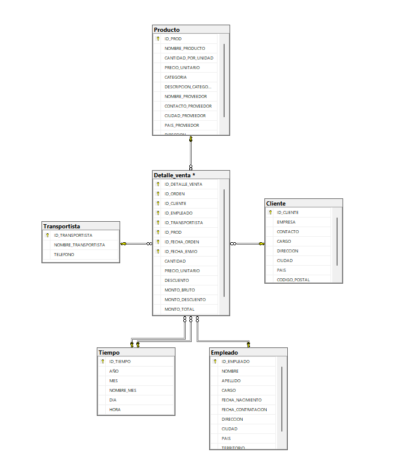

# Proyecto de Inteligencia de Negocios: Kent Foods 


## Información de equipo de trabajo (Fase 1)
- Felipe Gamboa Olivares
- Osvaldo Donoso Alarcon
- Gonzalo Cayupil Duque


## Sección y Asignatura (Fase 1)
- **Asignatura**: Inteligencia de negocios
- **Sección**: Paralelo 300
- **Docente**: Hernan Marcelo Saavedra Gonzalez


## Caso Seleccionado (Fase 1)

El caso de estudio corresponde a la empresa **Kent Foods**, una organización comercial dedicada a la venta y distribución de productos alimenticios mediante despachos a domicilio y envíos. La compañía ha experimentado un crecimiento acelerado durante los últimos años, lo que ha generado una acumulación significativa de registros operacionales en su base de datos transaccional (cubriendo clientes, colaboradores, catálogo de alimentos, proveedores, transportistas y órdenes de compra con sus respectivos detalles). Ante esta expansión, el propietario de la organización requiere incorporar una arquitectura de Inteligencia de Negocios que permita transformar dichos registros operativos en información estructurada para la toma oportuna de decisiones.


## Descripción del problema (Fase 1)

Debido al rápido crecimiento en el volumen de operaciones de Kent Foods, los directivos y encargados de área enfrentan dificultades para evaluar el desempeño real del negocio a partir de su base de datos relacional transaccional (OLTP).

## Objetivo del Proyecto (Fase 1)

Diseñar e implementar una solución de Inteligencia de Negocios para la empresa Kent Foods, estructurando un Data Warehouse dimensional mediante la metodología Kimball y desarrollando un flujo automatizado de Extracción, Transformación y Carga (ETL) en SQL Server Integration Services (SSIS), con el fin de suministrar información confiable y métricas consolidadas que optimicen la toma de decisiones estratégicas del propietario y la gerencia.


## Creación del modelo dimensional (Fase 1)

Para este proceso de negocio, se escogerá el modelo dimensional "**TIPO ESTRELLA**", que nos ayudará a desnormalizar las tablas operacionales y optimizar las consultas SQL


- **Proceso de negocio**: Proceso de ventas y despacho de alimentos a clientes

- **Granularidad**: fila/item de producto por venta

- **Dimensiones**: DIM_CLIENTE, DIM_PRODUCTO, DIM_EMPLEADO, DIM_TIEMPO, DIM_TRANSPORTISTA

- **Medidas**: cantidad, precio_unitario, descuento, monto_bruto(**cantidad x precio_unitario**), monto_descuento(**cantidad x precio_unitario x descuento**), monto_total (**monto_bruto - monto_descuento**), dias_despacho

- **Tabla de hechos**: FACT_DETALLE_VENTA, la cual almacena la dimensión degenerada `id_orden` y las claves foráneas de las dimensiones (id_cliente, id_producto, id_empleado, id_fecha_orden, id_fecha_envio, id_transportista)

### Esquema dimensional (Fase 1)




## KPIs definidos (Fase 1)

- **Ventas Netas Totales**: 
    - **Fórmula analítica:** $\sum \text{MontoNeto} = \sum (\text{Cantidad} \times \text{PrecioUnitario} \times (1 - \text{Descuento}))$. 

    - **Dimensiones de análisis:** Dim_Tiempo (mes, dia, año), Dim_Producto (categoría de alimentos), Dim_Cliente (país/ciudad).

    - **Justificación de negocio:** Es el indicador principal de salud comercial y crecimiento financiero de Kent Foods. Permite monitorear si las metas de ingresos se están cumpliendo a lo largo del tiempo e identificar qué líneas de alimentos traccionan la mayor recaudación.

- **Concentración de Ventas por Categoría de Alimento**
    - **Fórmula analítica:** $\frac{\text{Ventas Netas por Categoría}}{\text{Ventas Netas Totales}} \times 100$.
    
    - **Dimensiones de análisis:** Dim_Producto (Categoria, Proveedor).

    - **Justificación de negocio:** Detecta qué categorías de alimentos concentran el mayor volumen de negocio y cuáles tienen baja rotación, facilitando decisiones estratégicas de abastecimiento con proveedores y gestión de inventario.

- **Desempeño y Ranking de Mejores Proveedores**
    
    - **Fórmula análitica:** $\sum (\text{Cantidad} \times \text{PrecioUnitario} \times (1 - \text{Descuento})) \quad \text{agrupado por } \text{NombreProveedor}$

    - **Dimensiones de análisis:** Dim_Producto (NombreProveedor, PaisProveedor, NombreCategoria).   Dim_Tiempo (Anio, Trimestre, Mes). 
    
    - **Justificación de negocio:** Kent Foods comercializa productos alimenticios elaborados por terceros. Medir el rendimiento de cada proveedor permite a la gerencia:   Identificar socios estratégicos clave para negociar mejores acuerdos de compra por volumen o descuentos por pronto pago.Evaluar el riesgo de dependencia frente a un proveedor específico.Detectar proveedores con baja rotación o catálogo de alimentos poco demandado para renegociar contratos o reemplazarlos. 

- **Tiempo Promedio de Entrega y Despacho**
    
    - **Formula analítica:** $$\frac{\sum (\text{FechaEnvio} - \text{FechaOrden})}{\text{Cantidad Total de Órdenes Despachadas}}$$

    - **Justificación del negocio:** Dado que el modelo comercial de la empresa se basa en el envío de alimentos perecibles y no perecibles, la velocidad del despacho es crítica para asegurar la frescura de los productos y la satisfacción del consumidor.


## Script SQL (build_script.sql) y Estructura de Base de Datos (Fase 1)
La base `KentFoodsDW` se crea con un modelo en estrella: 5 dimensiones y 1 tabla de hechos, unidas por claves foráneas. El script borra y recrea la base garantizando integridad estructural.

- **Dim_Transportista:** Empresa que despacha el pedido. Campos: `ID_TRANSPORTISTA` (PK), `NOMBRE_TRANSPORTISTA` y `TELEFONO`.
- **Dim_Producto:** Productos vendidos, con su categoría y proveedor aplanados en una sola tabla (desnormalización). Campos: `ID_PROD` (PK), `NOMBRE_PRODUCTO`, `CANTIDAD_POR_UNIDAD`, `PRECIO_UNITARIO`, `CATEGORIA`, `DESCRIPCION_CATEGORIA`, `NOMBRE_PROVEEDOR`, `CONTACTO_PROVEEDOR`, `CIUDAD_PROVEEDOR`, `PAIS_PROVEEDOR` y `DIRECCION`.
- **Dim_Empleado:** Empleados que gestionan las ventas y su ubicación. Campos: `ID_EMPLEADO` (PK), `NOMBRE`, `APELLIDO`, `CARGO`, `FECHA_NACIMIENTO`, `FECHA_CONTRATACION`, `DIRECCION`, `CIUDAD`, `PAIS` y `TERRITORIO`.
- **Dim_Cliente:** Empresas que compran. Campos: `ID_CLIENTE` (PK), `EMPRESA`, `CONTACTO`, `CARGO`, `DIRECCION`, `CIUDAD`, `PAIS` y `CODIGO_POSTAL`.
- **Dim_Tiempo:** Calendario utilizado para la fecha de orden y la de envío. Campos: `ID_TIEMPO` (PK, formato AAAAMMDD), `AÑO`, `MES`, `NOMBRE_MES`, `DIA` y `HORA`.
- **Fact_Detalle_venta:** Tabla de hechos transaccional, con una fila por producto dentro de una orden (grano).
- **Claves:** Llave primaria compuesta por todas las claves del grano: `ID_ORDEN` (dimensión degenerada), `ID_PROD`, `ID_CLIENTE`, `ID_EMPLEADO`, `ID_TRANSPORTISTA`, `ID_FECHA_ORDEN` e `ID_FECHA_ENVIO`. Las claves `ID_PROD`, `ID_CLIENTE`, `ID_EMPLEADO`, `ID_TRANSPORTISTA`, `ID_FECHA_ORDEN` e `ID_FECHA_ENVIO` son además claves foráneas hacia sus dimensiones (se usa 20180101 como valor por defecto para fechas nulas).
  - **Medidas:** `CANTIDAD`, `PRECIO_UNITARIO`, `DESCUENTO` (entre 0 y 1), `MONTO_BRUTO`, `MONTO_DESCUENTO`, `MONTO_TOTAL` y `DIAS_DESPACHO`. Definidas estrictamente como `DECIMAL(14,2)` para exactitud financiera.

## Proceso ETL (SSIS) (Fase 1)
El proceso de Extracción, Transformación y Carga (ETL) se desarrolló utilizando SQL Server Integration Services (SSIS) mediante Visual Studio, implementando un flujo de trabajo orquestado y 100% automatizado.

**Arquitectura de Conexiones:**
* **Origen:** Conexión OLE DB apuntando a la base de datos transaccional original (`KentFoods`).
* **Destino:** Conexión OLE DB apuntando al Data Warehouse (`KentFoodsDW`).

**Orquestación del Flujo de Control (Control Flow):**
El paquete ETL fue diseñado para ejecutarse en cascada mediante **Restricciones de Precedencia** (Precedence Constraints). Esto garantiza el orden lógico de carga requerido por el modelo dimensional: primero la generación del tiempo, luego la población paralela/secuencial de las dimensiones, y finalmente la tabla de hechos, evitando errores de integridad referencial.


**Progreso de Carga de Tablas:**
- **Dimensión Tiempo:** Se automatizó completamente su creación dentro del *Control Flow* de SSIS integrando un componente **Execute SQL Task**. Este ejecuta un script T-SQL que calcula automáticamente el rango de fechas calendario basándose en las operaciones reales de la tabla de órdenes.
- **Dimensión Transportista:** Extracción directa logrando una transferencia exitosa hacia la tabla destino `[dbo].[Dim_Transportista]`.
- **Dimensión Cliente:** Se integró un componente de Columna Derivada para gestionar los valores nulos del campo CodigoPostal mediante la función `REPLACENULL`, transfiriendo 91 filas hacia `[dbo].[Dim_Cliente]`.
- **Dimensión Producto:** Se integraron las tablas Productos, Categorías y Proveedores. Se implementó un componente de Conversión de Datos para transformar tipos `ntext` a `DT_WSTR`, transfiriendo 77 filas hacia `[dbo].[Dim_Producto]`.
- **Dimensión Empleado:** Se cargó uniendo Empleados y Territorios mediante una subconsulta con `MIN(TerritorioID)` para evitar duplicados. Carga exitosa de 49 filas en `[dbo].[Dim_Empleado]`.
- **Tabla de Hechos (Fact_Detalle_venta):** Se configuró la carga de 2,155 filas operativas. Incorpora métricas precalculadas y blindadas mediante `CAST` explícito para encajar en el formato `DECIMAL(14,2)` del Data Warehouse.La unicidad del grano (una fila por producto dentro de una orden) queda garantizada por la llave primaria compuesta, formada por `ID_ORDEN` y todas las claves foráneas de las dimensiones, garantizando un modelo analítico robusto y libre de duplicados.


## Cubo OLAP KentFoods (Fase 2)

El cubo `Kent Foods DW` se construyó con SQL Server Analysis Services
(modo multidimensional, almacenamiento MOLAP) sobre el DW `KentFoodsDW`.
Proyecto: `olep/proyecto_sass/Cubo_olap/`.

**Origen de datos.** Conexión OLE DB a `KentFoodsDW` (`Data Source=.`),
con suplantación de la cuenta de servicio de SSAS, que tiene `db_datareader`
sobre la base. El Data Source View incluye las 5 dimensiones y
`Fact_Detalle_venta`, unidas por las claves foráneas del modelo estrella.

**Dimensiones.**
| Dimensión del cubo | Origen | Clave | Jerarquías |
|---|---|---|---|
| Dim Cliente | Dim_Cliente | ID_CLIENTE | [País → Ciudad → Empresa] |
| Dim Producto | Dim_Producto | ID_PROD | [Categoría → Producto]; [País proveedor → Proveedor → Producto] |
| Dim Empleado | Dim_Empleado | ID_EMPLEADO | [País → Ciudad → Empleado] |
| Dim Transportista | Dim_Transportista | ID_TRANSPORTISTA | Sin jerarquía |
| ID FECHA ORDEN | Dim_Tiempo | ID_FECHA_ORDEN | calendario (Año → Mes → Día) |
| ID FECHA ENVIO | Dim_Tiempo | ID_FECHA_ENVIO | calendario (Año → Mes → Día) |

`Dim_Tiempo` se usa como dimensión de rol múltiple: una sola tabla,
vinculada a la fecha de orden y a la de envío.

**Medidas** (grupo `Fact Detalle Venta`).
| Medida | Columna | Agregación |
|---|---|---|
| CANTIDAD | CANTIDAD | Sum |
| MONTO BRUTO / MONTO DESCUENTO / MONTO TOTAL | columnas homónimas | Sum |
| DIAS DESPACHO | DIAS_DESPACHO | Sum (solo base del promedio) |
| Recuento Dias Despacho | DIAS_DESPACHO | Count (órdenes con envío) |
| Recuento Fact Detalle Venta | — | Count |

**Miembros calculados.**
| Miembro | Fórmula |
|---|---|
| Ventas Netas Totales | MONTO TOTAL |
| Concentracion Ventas % | MONTO TOTAL / MONTO TOTAL de todos los productos |
| Ranking Proveedor | Posición del proveedor ordenado por MONTO TOTAL |
| Tiempo Promedio Despacho (dias) | DIAS DESPACHO / Recuento Dias Despacho |

**Validación.** [Captura del Navegador con cada KPI]. Ejemplo:
`SELECT {[Measures].[Ventas Netas Totales]} ON 0,
[Dim Producto].[CATEGORIA].[CATEGORIA].Members ON 1 FROM [Kent Foods DW]`
Cotejado contra: `SELECT CATEGORIA, SUM(MONTO_TOTAL) ... GROUP BY CATEGORIA`.


#### Proceso de creación cubo MOLAP (Osvaldo Donoso)
1. Proyecto Analysis Services Multidimensional y Data Source `KentFoodsDW`.
2. Data Source View con las 6 tablas y sus relaciones.
3. Cube Wizard con `Fact_Detalle_venta` como grupo de medidas.
4. Dimensión de rol múltiple para las dos fechas.
5. Jerarquías y relaciones de atributos.
6. Medidas, miembros calculados (MDX) y KPI.
7. Implementar y procesar (Process Full); validar en el Navegador.

## PowerBI de KentFoods (Fase 2)

x
x
x
x
x
x
x

## Tecnologías Utilizadas (Fase 2)

Este proyecto utiliza el siguiente conjunto de herramientas y tecnologías para el desarrollo, gestión de bases de datos, integración, análisis y visualización de datos:


*   **Visual Studio:** Entorno de desarrollo integrado principal. Usado en la creación del proceso ETL y Cubo MOLAP del proyecto

*   **Visual Studio Code:** Editor de código. Usado para la creación de código SQL, scripts, documentación del readme y estructura del proyecto

*   **SQL Server Management Studio (SSMS):** Ejecución de los scripts SQL (creación del DW, carga de dimensiones y tabla de hechos) y administración de las bases de datos.

*   **SQL Server 2019 SSEI (SQL Server Express Edition / Evaluation / Installation):** Motor de base de datos donde se aloja la base transaccional `KentFoods` y el Data Warehouse `KentFoodsDW`. 
*   **Microsoft.DataTools.IntegrationServices (SSIS):** Extensión de Visual Studio para SQL Server Integration Services (SSIS), utilizada para construir el proceso ETL.

*   **Microsoft.DataTools.AnalysisServices (SSAS):** Extensión de Visual Studio para SQL Server Analysis Services (SSAS), utilizada para diseñar el cubo OLAP multidimensional. |

*   **Power BI:**  Visualización de los KPIs y construcción del dashboard de la solución.

*   **Github Desktop**: Usado para la actualización de cambios en el proyecto

## Estructura del repositorio (Fase 2)

```
proyecto_bi_usm/
├── .gitignore
├── README.md
├── database/
│   ├── backup/
│   │   └── KentFoodsDW_backup.bak
│   └── scripts/
│       ├── build_script.sql
│       ├── cargar_dim_empleado.sql
│       ├── cargar_dim_producto.sql
│       ├── cargar_fact_detalle_venta.sql
│       └── poblar_tiempo_script.sql
├── docs/
│   ├── modelo-dimensional/
│   │   └── modelo dimensional.png
│   └── presentacion/
│       └── Proyecto BI Kent Foods.pptx
├── etl/
│   └── KentFoodETL/
│       ├── KentFoodETL.database
│       ├── KentFoodETL.dtproj
│       ├── KentFoodETL.sln
│       ├── Package.dtsx
│       └── Project.params
├── olep/
│   ├── proyecto_sass/
│   │   └── ProyectoMultidimensional1/
│   │       ├── ProyectoMultidimensional1.sln
│   │       └── ProyectoMultidimensional1/
│   │           ├── Dim Cliente.dim
│   │           ├── Dim Empleado.dim
│   │           ├── Dim Producto.dim
│   │           ├── Dim Tiempo.dim
│   │           ├── Dim Transportista.dim
│   │           ├── Kent Foods DW.cube
│   │           ├── Kent Foods DW.ds
│   │           ├── Kent Foods DW.dsv
│   │           ├── Kent Foods DW.partitions
│   │           ├── ProyectoMultidimensional1.database
│   │           └── ProyectoMultidimensional1.dwproj
│   └── to_save
└── powerbi/
    └── to_save

```

## Instrucciones de Ejecución y Revisión (Fase 2)


#### Base de datos Dimensional (Osvaldo Donoso)

**Requisitos:** SQL Server, SSMS y la base original `KentFoods` en la misma instancia.

**Opción A: restaurar el backup**
1. En SSMS: *Bases de datos* → *Restaurar base de datos...* → `database/backup/KentFoodsDW_backup.bak`.
2. En *Opciones*: marcar *WITH REPLACE* y *Cerrar conexiones existentes*, y desmarcar la copia del final del registro.

**Opción B: construir desde cero**
1. Ejecutar `database/scripts/build_script.sql`, que recrea `KentFoodsDW` con las 5 dimensiones y la tabla de hechos.
2. Ejecutar el paquete ETL para poblar tiempo, dimensiones y hechos.

**Validación:** `SELECT COUNT(*)` en cada tabla. Se esperan 91 clientes, 77 productos, 49 empleados y 2.155 filas de hechos.


#### Proceso ETL (Gonzalo Cayupil)

x
x
x

#### Proceso de creación cubo MOLAP (Osvaldo Donoso)

**Requisitos:** Visual Studio con la extensión de Analysis Services, una instancia de SSAS multidimensional y `KentFoodsDW` cargada.

1. Abrir `olep/proyecto_sass/ProyectoMultidimensional1/Kentfood_cube.sln`.
2. En `Kent Foods DW.ds`, revisar que el servidor y la base (`KentFoodsDW`) coincidan con tu instancia. La cuenta de servicio de SSAS necesita el rol `db_datareader` sobre la base.
3. Clic derecho en el proyecto → *Implementar*, y luego *Procesar* con **Process Full**.
4. Verificar en el *Navegador* del cubo: `MONTO TOTAL` por año debe mostrar valores, y cada KPI de la pestaña *KPI* debe mostrar valor, meta y estado.

**Contenido del cubo:** grupo de medidas `Fact Detalle Venta`, 5 dimensiones (Tiempo con rol doble: orden y envío), 4 miembros calculados (`Ventas Netas Totales`, `Concentracion Ventas %`, `Ranking Proveedor`, `Tiempo Promedio Despacho (dias)`) y 4 KPI.

**Problemas frecuentes:** el error de conexión suele ser de permisos de la cuenta de SSAS, y el de clave de tiempo no encontrada se resuelve repitiendo Process Full con `Dim_Tiempo` poblada.

#### Visualización de metricas en Power BI (Felipe Gamboa y Gonzalo Cayupil)

x
x
x

## Distribución de Responsabilidades y Aportes (Fase 2)

### [Felipe Gamboa Olivaes] – Fase 1: Análisis del caso y diseño del modelo dimensional

Fue responsable de la Fase 1 del proyecto, en la que se definió la base conceptual y el diseño analítico sobre el cual se construyeron las etapas posteriores (Data Warehouse, ETL y cubo OLAP). Sus aportes fueron:

- **Planteamiento del caso y del problema:** Redactó la descripción del caso de estudio de Kent Foods y la problemática asociada a la evaluación del desempeño del negocio a partir de su base de datos transaccional (OLTP).
- **Definición del objetivo:** Formuló el objetivo del proyecto, orientado a implementar una solución de Inteligencia de Negocios con un Data Warehouse dimensional (metodología Kimball) y un proceso ETL en SSIS.
- **Diseño del modelo dimensional:** Eligió el esquema tipo estrella y definió el proceso de negocio (ventas y despacho de alimentos), la granularidad (un ítem de producto por venta), las cinco dimensiones (cliente, producto, empleado, tiempo y transportista), las medidas y la tabla de hechos `FACT_DETALLE_VENTA`, incluyendo la dimensión degenerada `id_orden` y sus claves foráneas.
- **Diagrama del esquema dimensional:** Elaboró el diagrama del modelo en estrella incluido en la documentación.
- **Definición de KPIs:** Estableció los cuatro indicadores clave del proyecto (Ventas Netas Totales, Concentración de Ventas por Categoría, Desempeño y Ranking de Proveedores, y Tiempo Promedio de Entrega y Despacho), con su fórmula analítica, dimensiones de análisis y justificación de negocio.
- **Documentación inicial:** Redactó las secciones iniciales del README (equipo de trabajo, asignatura, caso, problema, objetivo, modelo dimensional y KPIs).


... Sección en desarrollo